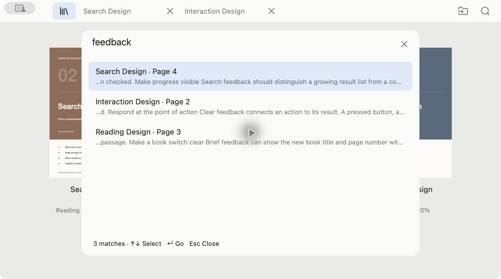
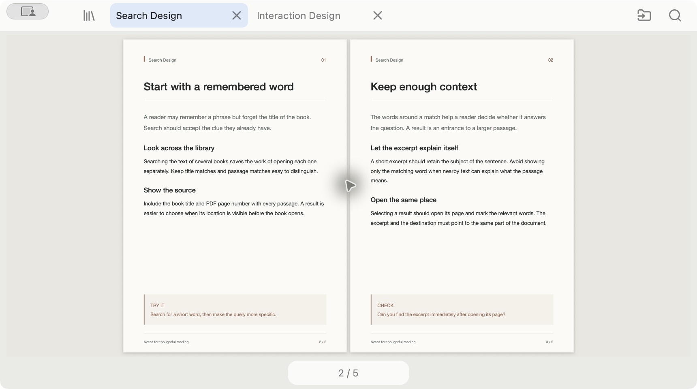

# Sumi

PDFを横断して、探していた一節へ。

本のタイトルを覚えていなくても、本文の言葉から探せます。Command Kで読み込んだPDFをまとめて検索し、結果を選ぶと該当ページへ移動します。

[macOS版をダウンロード](https://github.com/kairi7011/sumi-reader/releases/tag/v0.7.0) · [紹介動画](https://github.com/kairi7011/sumi-reader/releases/download/v0.7.0/Sumi-0.7.0-demo.mp4) · [English](README.md)

## 本文から探す

検索結果には書名・ページ番号・本文の抜粋が並びます。どの本に書いてあったかを思い出す前に、気になる言葉で探せます。書名、ページ、アプリの操作も同じ検索欄から選べます。

テキストを含むPDFが対象です。画像だけのPDFへのOCRや正規表現検索には対応していません。コピーが禁止されたPDFの本文は検索しません。

## 見つけたページを読む

本棚とタブで本を切り替え、単ページまたは見開きで読めます。ページ一覧から移動し、必要なところだけ拡大できます。本文のコピーや範囲を指定した画像の切り抜きにも対応しています。

必要なら、別途作成したローカル索引をMCP経由でAIクライアントにつなげられます。[設定方法](docs/local-library.md)を確認してください。クラウドのAIを使う場合、取得した抜粋はそのクライアントに渡ります。

## 使い始める

Apple Silicon搭載Mac、macOS 13以降が必要です。アプリを開き、PDFやフォルダをドロップするか、Command Oで選んでください。元のPDFを移動・コピーせず、本棚に登録します。

主な操作はCommand Kで検索、Command Lで本棚、ページ番号のクリックでページ一覧です。詳しくは[操作ガイド](docs/usage.md)を参照してください。

現在の配布版は、アドホック署名のプレビュー版です。Appleによる公証は未実施のため、ダウンロードしたアプリがGatekeeperに止められる場合があります。Developer ID署名・公証済みの製品版ではありません。

## ローカルで使う

SumiはRustとmacOSのAppKit・PDFKitで実装しています。ブラウザエンジン、アカウント登録、テレメトリー、自動アップロードはありません。本棚や読書位置はMac内に保存します。[プライバシー](PRIVACY.md)と[セキュリティ](SECURITY.md)の説明も確認できます。

スクリーンショットと動画には、このプロジェクトで作成したサンプル文書を使用しています。実際の購入書籍や個人の読書履歴は含めていません。

## ライセンスと開発

Apache License 2.0で公開しています。依存ライブラリやアイコンにはそれぞれのライセンスが適用されます。[LICENSE](LICENSE)と[第三者ライセンス](THIRD_PARTY_NOTICES.md)を参照してください。

ビルド方法は[英語版README](README.md#build-from-source)、変更の提案方法は[CONTRIBUTING](CONTRIBUTING.md)に記載しています。
