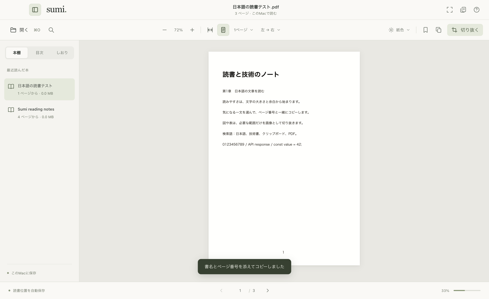

# Sumi

A quiet, personal PDF reader for macOS. Built for long reading sessions and taking excerpts into your own AI conversations.

Private project owned by **kairi7011**. Documents stay on your Mac. There is no account, telemetry, cloud upload, or AI API integration.

## Development

Requires an Apple Silicon Mac and Node.js 22.13 or newer. Dependency installation is deliberately script-free; consult `docs/dependency-review.md` before installing or updating dependencies. Runtime setup checks the official release age and pinned SHA-256 before extraction. Starting the app never downloads code.

```sh
npm ci --ignore-scripts --omit=optional
npm run setup:runtime
npm start
npm test
npm run test:smoke
npm run package:mac
```

## Reading

- Open a local PDF or drop it onto the window.
- Read one page or a facing spread, with left-to-right or right-to-left navigation.
- Fit a page or its width, zoom, switch paper colors, and hide controls for focused reading.
- Resume reading from recent documents; bookmark pages and navigate the PDF outline.
- Search document text, select text, and collect excerpts with their source page.
- Drag a rectangle over a page to copy a clean PNG or save it to disk.

Scanned PDFs can be captured as images; OCR is not included. Password-protected PDFs request a password for the current session. The original PDF is never modified.

The clipping tray is temporary: save images or copy excerpts before quitting. Text copied through the reader includes the PDF filename and page number. Images use the original page colors, even in night mode.



## Local packaging

`npm run package:mac` produces `dist/Sumi.app` using the installed Electron runtime. This personal build is ad-hoc signed, not notarized. Building on Apple Silicon produces an Apple Silicon app.

## Keyboard shortcuts

| Action | Shortcut |
| --- | --- |
| Open PDF | Command O |
| Find text | Command F |
| Previous / next page | Left / right arrow |
| Bookmark current page | Command D |
| Zoom | Command + / - |
| Fit page | Command 0 |
| Focus mode | Command Shift F |
| Capture a rectangle | Command Shift X |
| Copy selected text with source | Command C |
| Cancel capture / leave focus mode | Escape |

## Verification and limits

The initial build passed ten unit tests and thirty-two checks in a real Electron window, including native text/PNG clipboard, reading-state restoration, Japanese PDFs, password handling, repeated open requests, and compact layouts. The smoke test creates original fixtures, isolates its reading history, and restores clipboard contents. It requires the macOS command line tools for the Japanese PDF fixture.

See [verification notes](docs/verification.md) for evidence and limits. This version supports PDFs up to 250 MiB. It renders at most two pages, caps each canvas backing store at 14 million pixels, and retains a bounded session clipping collection. It does not include OCR, annotation editing, continuous scrolling, cloud sync, or direct AI integration. PDF extraction follows the source document's text order; complex multicolumn documents can need cleanup after copying.

Electron's bundled browser has a substantial disk and memory cost. These rendering limits keep document work bounded; they do not make Electron as small as a system-WebView application.
