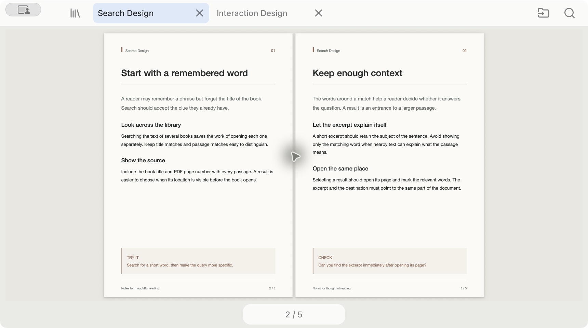
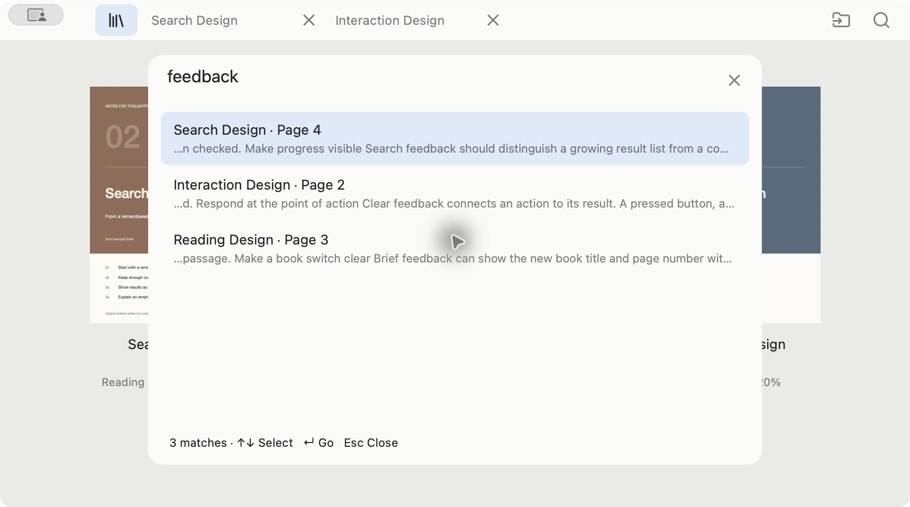

# Sumi

A small native PDF reader for macOS, with a bookshelf, reading tabs, and search across your books.

[日本語](README.ja.md) · [Download the macOS preview](https://github.com/kairi7011/sumi-reader/releases/tag/v0.10.0) · [Watch real app operation](https://github.com/kairi7011/sumi-reader/releases/download/v0.8.0/Sumi-0.8.0-workflow-en.mp4)


## Read with less in the way

Keep several books open in tabs and switch back to the same page and zoom. Read a complete page or facing spread without scrolling at the fitted size. Turn pages from the edges, keyboard, or horizontal trackpad gestures; use a vertical thumbnail grid to jump anywhere in the book. Zoom in place to inspect a detail, then return with Command 0 or Escape.

When you reopen Sumi, it restores your tab order, selected book or Home, and each tab's page, zoom, and in-book search query. Command Shift W closes all book tabs while keeping the books and saved reading positions in your library. If you close every book tab before quitting, Sumi reopens Home without any book tabs. PDF passwords are never saved; protected books ask again after relaunch.

The import and search icons stay compact. Command K holds the less frequent actions, and focus mode hides the reader controls. Appearance and language are shared across all books. Choose English, Japanese, or the system language from the Sumi menu.

If opening a book, searching, importing, or loading covers or page thumbnails takes longer than 400 ms, a loading indicator appears. It disappears when the operation finishes or is cancelled.



## Find the passage, even when you forgot the book

Type in Command K to search titles, page text, and app actions together. Text results include the book title, page number, and a short excerpt. Choose one to open the matching page. Command F searches the current book.



The 0.8.0 video records actual typing, results from multiple PDFs, and opening a selected result, followed by reading operations. It uses original sample documents. It is not a sequence of still images or a benchmark.

Search requires selectable text and respects PDF copy permissions. It is keyword search, not regular-expression grep; OCR is not included.

## Bring a passage into your work

Select and copy text, or copy a passage with its book title and page number. Drag a rectangle to capture a diagram as an image without opening another window. An optional local index exposes selected excerpts to your own AI client through MCP; see [local library tools](docs/local-library.md). Sumi does not include an AI service or send books to one automatically.

Sumi is written in Rust with native AppKit controls and Apple's PDFKit renderer. It has no browser engine, account, telemetry, or cloud upload. The interface supports English and Japanese.

## Requirements

Apple Silicon Mac, macOS 13 or later. Intel Macs, Windows, and Linux are not supported. The packaged reader needs no Node.js, Rust, or Python installation. The optional book-index tool has its own [requirements](docs/local-library.md).

## Getting started

Open Sumi, then drop a PDF or folder onto the window, or press **Command O**. Files stay in their original locations. Use **Command K** for search and actions, **Command L** for the bookshelf, and the page counter to jump through thumbnails.

See the [reading guide](docs/usage.md) for navigation, tabs, search, capture, and keyboard shortcuts.

## Build from source

Install Apple's Command Line Tools, Node.js 22.13 or later, and Rust 1.99.1 for `aarch64-apple-darwin`. Python 3.9 or later is required for tests. Native builds do not need npm dependencies.

```sh
git clone https://github.com/kairi7011/sumi-reader.git
cd sumi-reader
# Populate the pinned Cargo cache once; this step downloads dependencies.
cargo +1.99.1 fetch --locked --manifest-path src-native/Cargo.toml --target aarch64-apple-darwin
npm run check
npm test
npm run package:mac
```

Builds use `--locked --offline`. The build scripts support an installed pinned rustup toolchain, matching tools on PATH, or explicit `SUMI_RUST_BIN` / `CARGO_HOME` paths. They do not install compilers or search private workspace folders. See the [dependency review](docs/dependency-review-native.md) before changing dependencies.

The result is `dist/Sumi.app`. This project currently produces **ad-hoc signed, unnotarized preview builds**. They are not Developer ID releases; a downloaded build may be blocked by Gatekeeper. Do not disable macOS security checks globally. Release preparation and signing requirements are documented in [distribution](docs/distribution.md).

## Data and privacy

Sumi stores book paths, reading positions, bookmarks, preferences, and your tab session on your Mac, including each tab's zoom and in-book search query. It does not copy PDFs into the app or upload them. The optional MCP index is opt-in; excerpts sent to an external AI client are subject to that client's data handling. See [privacy](PRIVACY.md) for storage locations and deletion.

OCR, annotation editing, continuous-scroll reading, cloud sync, and automatic updates are not included. See [security](SECURITY.md) for the current scope and reporting guidance.

## Contributing and license

Small fixes and reproducible bug reports are welcome. See [contributing](CONTRIBUTING.md). Please use synthetic PDFs in reports and tests; do not upload purchased books or private documents.

Copyright 2026 kairi7011. Sumi's source, original assets, and original fixtures are licensed under [Apache License 2.0](LICENSE). Third-party code and icons retain their own licenses; see [third-party notices](THIRD_PARTY_NOTICES.md).

The earlier Tauri implementation remains under `src/`, `src-tauri/`, and the `legacy:*` scripts as an unsupported prototype. It is not included in the native app. Historical verification reports describe their stated versions, not the current release.
